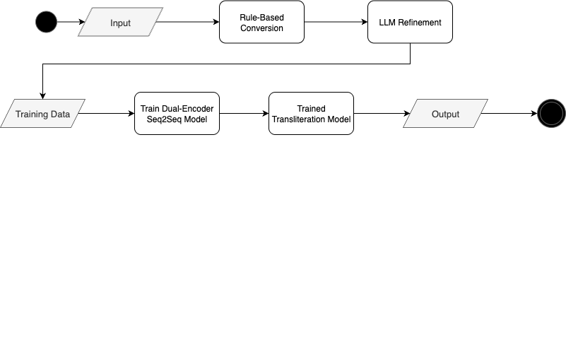
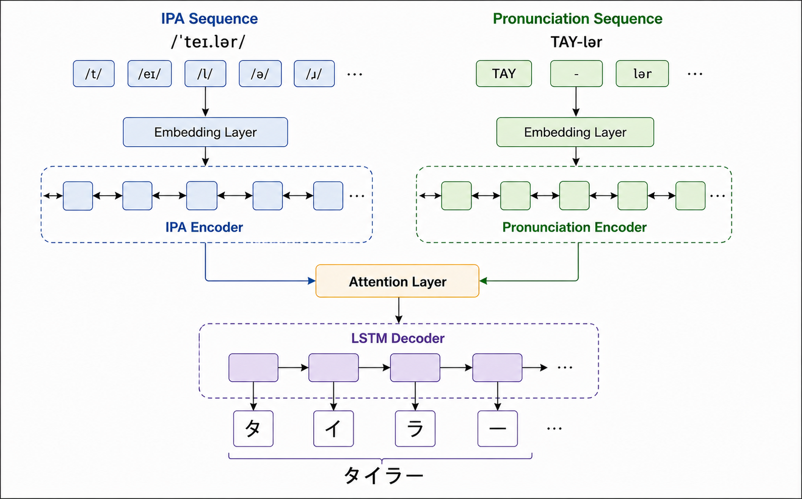
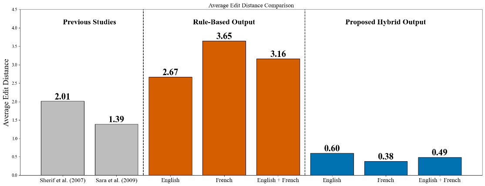
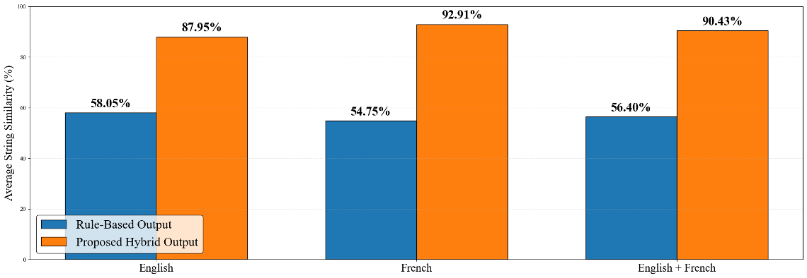

# 外国人名のカタカナ転写

[English](README.md) | **日本語**

英語とフランス語の名（ファーストネーム）を、発音に基づいて日本語のカタカナに変換するシステムです。ルールベースの変換、大規模言語モデル（LLM）による修正、注意機構を備えたデュアルエンコーダーの系列変換（Seq2Seq）モデルを組み合わせています。

**英語・フランス語を合わせた結果：** 報告された人手評価の正解率は 92.75%、平均編集距離は 0.49、平均文字列類似度は 90.43% です。

## 概要

外国人名には、つづりが同じでも発音が異なるものがあります。珍しい名前、地域によるアクセントの違い、言語固有の音があるため、アルファベットからカタカナへの直接変換は容易ではありません。

本プロジェクトでは、国際音声記号（IPA）と文字で表した発音ガイドを使用し、意図した発音を反映するカタカナを生成します。活用例として、日本語の入力フォームやフリガナ欄に外国人名を入力する際の支援が考えられます。

## データセット

**Behind the Name** から、Web スクレイピングによってファーストネームのデータを収集しました。

| 言語 | 収集件数 |
| --- | ---: |
| 英語 | 5,798 |
| フランス語 | 1,163 |
| **合計** | **6,961** |

英語のデータには、アメリカ英語とイギリス英語の発音が含まれます。各レコードには、名前、言語または由来、IPA 表記、文字で表した発音ガイドが含まれます。

| 項目 | 例 |
| --- | --- |
| 名前 | Aidan |
| 言語 | English |
| IPA | `/ˈeɪ.dən/` |
| 発音ガイド | `AY-dən` |

## システム設計

### ハイブリッド方式

ルールベースの変換と LLM による修正を通じて学習データを準備し、そのデータを使ってニューラルネットワークによる転写モデルを学習します。

1. **ルールベースの変換：** 発音からカタカナへの変換ルールを適用し、初期の転写結果を生成します。
2. **LLM による修正：** 初期のカタカナ出力を修正し、学習の正解となる出力データを作成します。
3. **Seq2Seq モデルの学習：** IPA と文字による発音の系列を用いて、カタカナを生成するデュアルエンコーダーモデルを学習します。

### デュアルエンコーダー Seq2Seq モデル

発音を表す2種類の相補的な情報を、それぞれエンコードします。

| 構成要素 | 役割 |
| --- | --- |
| IPA エンコーダー | 埋め込み層とエンコーダーを通じて、音声記号の系列をエンコードします。 |
| 発音エンコーダー | 独立した埋め込み層とエンコーダーを通じて、文字で表した発音の系列をエンコードします。 |
| 注意機構の層 | デコード時に、両方のエンコーダーの情報を利用します。 |
| LSTM デコーダー | カタカナの出力系列を生成します。 |

例えば、構成図では、**Taylor** の IPA と発音ガイドから **タイラー** を生成する流れを示しています。

## 評価

評価には、**無作為に抽出した英語の名前400件**と**フランス語の名前400件**を用い、**合計800件**を対象としました。人手評価には、日本語・英語・フランス語の母語話者が参加し、5段階の評価尺度を使用しました。

人手評価に加えて、文字に基づく2つの指標である編集距離と文字列類似度を報告しています。自動評価では、**ルールベースのベースライン**と**提案したハイブリッド方式の出力**を比較しています。

### 人手評価

| 言語 | 平均評価点 | 人手評価の正解率 |
| --- | ---: | ---: |
| 英語 | **4.56 / 5** | **91.50%** |
| フランス語 | **4.71 / 5** | **94.00%** |
| 英語 + フランス語 | **4.63 / 5** | **92.75%** |

平均評価点と人手評価の正解率（Human Accuracy）は、プロジェクトの評価で報告された数値をそのまま掲載しています。発表資料には、人手評価の正解率を算出する際に使用した評価点のしきい値が記載されていません。

#### 評価尺度

| 評価点 | 評価内容 |
| ---: | --- |
| 5 | 自然で正確 |
| 4 | わずかな違いはあるが許容できる |
| 3 | 理解できるが、明らかな誤りがある |
| 2 | 理解しにくい |
| 1 | 意図した発音を反映していない |

### 編集距離

編集距離は、生成されたカタカナを参照用のカタカナに変換するために必要な、文字の挿入・削除・置換の最小回数を表します。**値が小さいほど良く**、0 は完全一致を意味します。

| 言語 | ルールベースの出力 | 提案したハイブリッド方式の出力 |
| --- | ---: | ---: |
| 英語 | 2.67 | **0.60** |
| フランス語 | 3.65 | **0.38** |
| 英語 + フランス語 | 3.16 | **0.49** |

両言語を合わせた平均編集距離は **3.16 から 0.49** に低下しました。報告された丸め済みの平均値から算出すると、約 **84.49% の削減**となります。

図には、Sherif et al. (2007) と Sara et al. (2009) と表記された値も含まれています。これらは、プロジェクトの発表資料で参考情報として示されたものです。各研究のデータセットや評価条件はここでは記載されていないため、この図だけで本プロジェクトと条件をそろえた比較が行われたとはいえません。

#### 指標の例

| 名前 | 生成されたカタカナ | 参照用のカタカナ | 報告された編集距離 |
| --- | --- | --- | ---: |
| Gale | ガレ | ゲイル | 2 |
| Micheal | マイケル | マイケル | 0 |

発表資料では、Gale の編集距離を **2** と報告しています。一方、`ガレ` と `ゲイル` の標準的な文字単位のレーベンシュタイン距離は **3** です。元の例、または指標の実装について確認が必要ですが、この表には報告された値をそのまま掲載しています。

### 文字列類似度

文字列類似度は、生成されたカタカナが参照用のカタカナにどの程度近いかを表します。**割合が高いほど良い結果です。**

| 言語 | ルールベースの出力 | 提案したハイブリッド方式の出力 |
| --- | ---: | ---: |
| 英語 | 58.05% | **87.95%** |
| フランス語 | 54.75% | **92.91%** |
| 英語 + フランス語 | 56.40% | **90.43%** |

両言語を合わせた平均文字列類似度は **56.40% から 90.43%** に上昇し、**34.03 ポイント**改善しました。

#### 指標の例

| 名前 | 生成されたカタカナ | 参照用のカタカナ | 文字列類似度 |
| --- | --- | --- | ---: |
| Denis | デニス | デュニ | 66.67% |
| Hyacinthe | ハイアシント | ヤーサント | 36.36% |

これらは指標を説明するための例であり、最終的なハイブリッドモデルの予測例として示されたものではありません。発表資料では、文字列類似度の具体的な実装方法は明示されていません。

## 結果と制約

英語とフランス語の両方で、ハイブリッド方式はルールベースのベースラインよりも編集距離と文字列類似度を改善しました。また、人手評価でも高い平均評価点が得られ、両言語を合わせた値は **4.63 / 5** でした。

現在の評価は、限られたデータセットに含まれる英語とフランス語のファーストネームを対象としています。他の命名体系での性能を評価するには、対象言語を広げ、データを増やす必要があります。また、文字に基づく類似度は、発音の良し悪しではなく表記の違いを捉える指標であるため、本プロジェクトでは自然さを評価するための人手評価も行っています。

発表資料には学習・検証・テスト用データの分割方法が記載されていないため、報告された結果から、学習に使用していないことが確認されたテストセットでの性能を示すことはできません。

## 今後の課題

- データセットを拡充し、対応言語を増やす。
- 珍しい名前や言語固有の音への対応を改善する。
- 分割方法を明記した、学習に使用していないテストセットで評価し、再現可能な指標の定義を公開する。
- 発音情報を入力し、生成されたカタカナを確認できるユーザーインターフェースを検討する。
