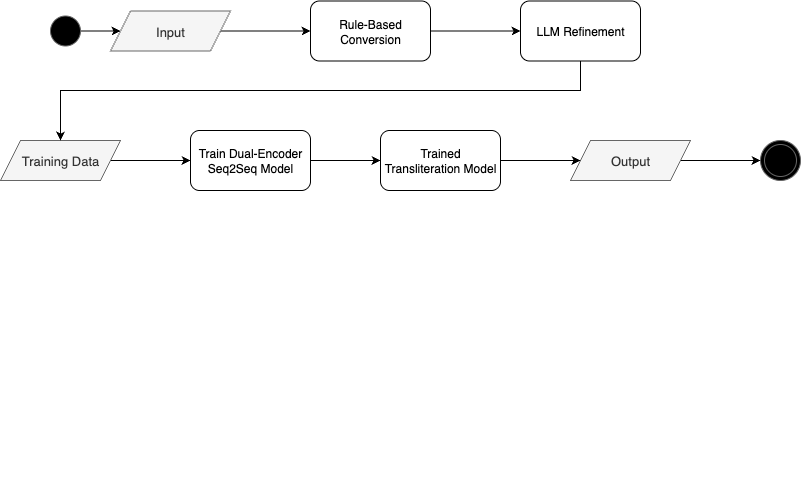
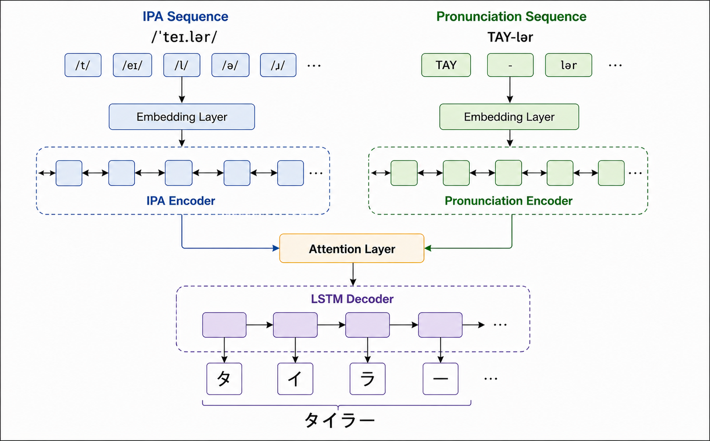
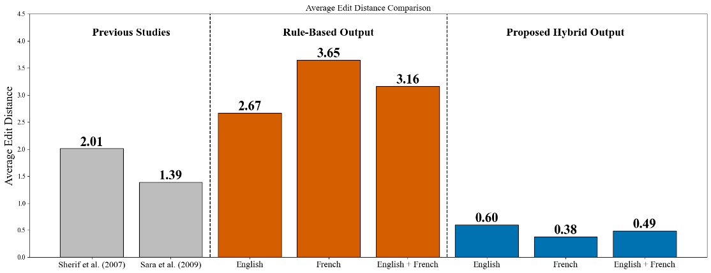
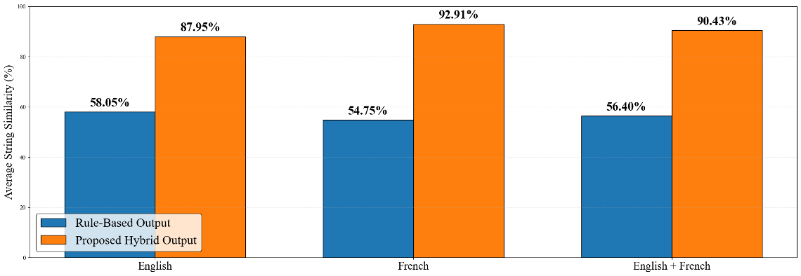

# Katakana Transliteration of Foreign Names

A pronunciation-based system that converts English and French first names into Japanese Katakana. The project combines rule-based conversion, large language model (LLM) refinement, and a dual-encoder sequence-to-sequence (Seq2Seq) model with attention.

**Combined English and French results:** 92.75% reported human accuracy, 0.49 average edit distance, and 90.43% average string similarity.

## Overview

Foreign names can have different pronunciations despite sharing the same spelling. Uncommon names, regional accents, and language-specific sounds make direct alphabet-to-Katakana conversion difficult.

This project uses the International Phonetic Alphabet (IPA) and written pronunciation guides to generate Katakana that reflects the intended pronunciation. A potential application is supporting the entry of foreign names in Japanese forms and Furigana fields.

## Dataset

The project collected first-name entries from **Behind the Name** through web scraping.

| Language | Collected entries |
| --- | ---: |
| English | 5,798 |
| French | 1,163 |
| **Total** | **6,961** |

The English data includes American and British pronunciation entries. Each record contains the name, language or origin, IPA transcription, and a written pronunciation guide.

| Field | Example |
| --- | --- |
| Name | Aidan |
| Language | English |
| IPA | `/ˈeɪ.dən/` |
| Pronunciation guide | `AY-dən` |

## System Design

### Hybrid Framework

The system prepares training data through rule-based conversion and LLM refinement, then trains a neural transliteration model.

1. **Rule-based conversion:** Apply pronunciation-to-Katakana rules to generate initial transliterations.
2. **LLM refinement:** Refine the initial Katakana outputs to prepare training targets.
3. **Seq2Seq learning:** Train a dual-encoder model using IPA and written pronunciation sequences to generate Katakana.

### Dual-Encoder Seq2Seq Model

The model encodes two complementary representations of pronunciation:

| Component | Role |
| --- | --- |
| IPA encoder | Encodes the phonetic-symbol sequence through an embedding layer and an encoder. |
| Pronunciation encoder | Encodes the written pronunciation sequence through a separate embedding layer and encoder. |
| Attention layer | Uses information from both encoders during decoding. |
| LSTM decoder | Generates the Katakana output sequence. |

For example, the architecture diagram illustrates how the IPA and pronunciation guide for **Taylor** lead to **タイラー**.

## Evaluation

The evaluation used **400 randomly sampled English names** and **400 randomly sampled French names**, for **800 names in total**. Native Japanese, English, and French speakers participated in the human evaluation using a five-point rating scale.

The project reports human evaluation alongside two character-based metrics: edit distance and string similarity. The automatic evaluation compares the **rule-based baseline** with the **proposed hybrid output**.

### Human Evaluation

| Language | Average Score | Human Accuracy |
| --- | ---: | ---: |
| English | **4.56 / 5** | **91.50%** |
| French | **4.71 / 5** | **94.00%** |
| English + French | **4.63 / 5** | **92.75%** |

Average scores and Human Accuracy percentages are reproduced as reported in the project evaluation. The presentation does not specify the rating threshold used to calculate Human Accuracy.

#### Rating Scale

| Score | Evaluation |
| ---: | --- |
| 5 | Natural and accurate |
| 4 | Minor differences but acceptable |
| 3 | Understandable with noticeable errors |
| 2 | Difficult to understand |
| 1 | Does not reflect the intended pronunciation |

### Edit Distance

Edit distance measures the minimum number of character insertions, deletions, or substitutions needed to transform the generated Katakana into the reference Katakana. **Lower values are better**, and zero indicates an exact match.

| Language | Rule-Based Output | Proposed Hybrid Output |
| --- | ---: | ---: |
| English | 2.67 | **0.60** |
| French | 3.65 | **0.38** |
| English + French | 3.16 | **0.49** |

The combined average edit distance decreased from **3.16 to 0.49**, an approximately **84.49% reduction** calculated from the reported rounded averages.

The figure also includes values labelled Sherif et al. (2007) and Sara et al. (2009). These are contextual references from the project presentation. Their datasets and evaluation settings are not documented here, so the figure does not establish a controlled comparison with this project.

#### Metric Examples

| Name | Generated Katakana | Reference Katakana | Reported Edit Distance |
| --- | --- | --- | ---: |
| Gale | ガレ | ゲイル | 2 |
| Micheal | マイケル | マイケル | 0 |

The presentation reports an edit distance of **2** for Gale. Standard character-level Levenshtein distance for `ガレ` and `ゲイル` is **3**. The original example or metric implementation needs confirmation; the table preserves the reported value.

### String Similarity

String similarity measures how closely the generated Katakana matches the reference Katakana. **Higher percentages are better.**

| Language | Rule-Based Output | Proposed Hybrid Output |
| --- | ---: | ---: |
| English | 58.05% | **87.95%** |
| French | 54.75% | **92.91%** |
| English + French | 56.40% | **90.43%** |

The combined average string similarity increased from **56.40% to 90.43%**, a gain of **34.03 percentage points**.

#### Metric Examples

| Name | Generated Katakana | Reference Katakana | String Similarity |
| --- | --- | --- | ---: |
| Denis | デニス | デュニ | 66.67% |
| Hyacinthe | ハイアシント | ヤーサント | 36.36% |

These examples illustrate the metrics and are not presented as examples of the final hybrid model's predictions. The exact string-similarity implementation is not specified in the presentation.

## Findings and Limitations

The hybrid system improved both edit distance and string similarity over the rule-based baseline for English and French. Human evaluators also gave the outputs high average ratings, with a combined score of **4.63 / 5**.

The current evaluation covers English and French first names within a limited dataset. Broader language coverage and more data are needed to assess performance across other naming systems. Character-based similarity also captures spelling differences rather than pronunciation quality, so the project includes human evaluation to assess naturalness.

The presentation does not document the train/validation/test split, so the reported results do not establish performance on a confirmed held-out test set.

## Future Work

- Expand the dataset and support additional languages.
- Improve handling of uncommon names and language-specific sounds.
- Evaluate on a documented held-out test set and publish reproducible metric definitions.
- Explore a user interface for entering pronunciation information and reviewing generated Katakana.

